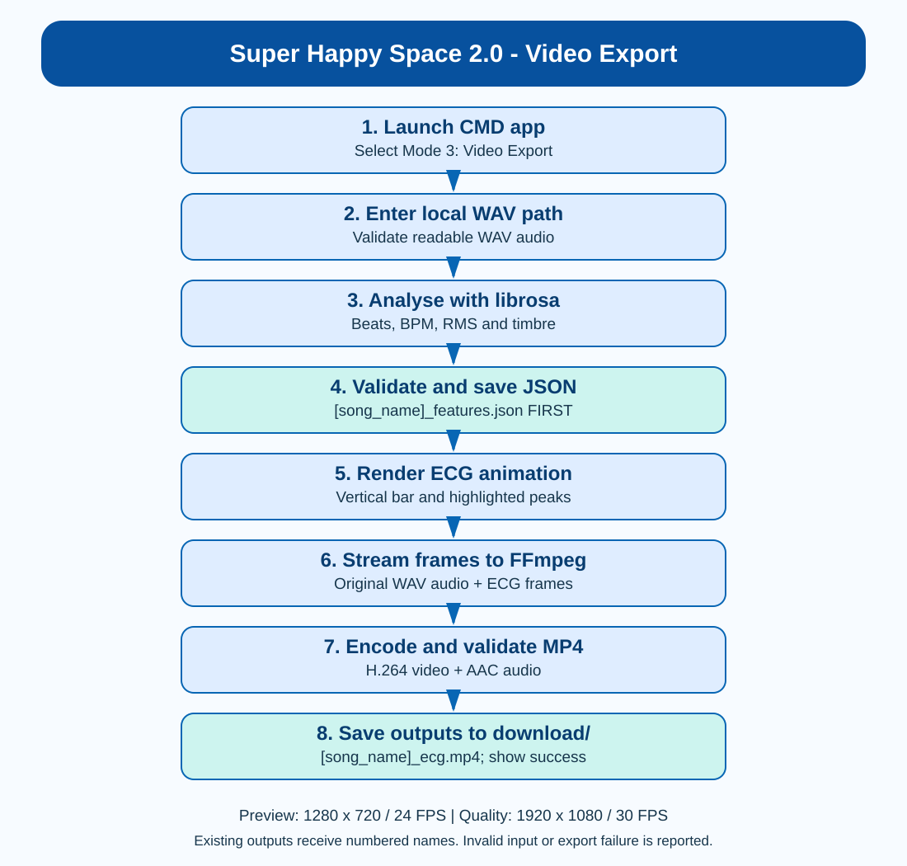

# Super Happy Space 2.0 — music analyser

Choose a mode in CMD: **[1] Offline Analysis** (WAV to features JSON),
**[2] Live Analysis** (capture Windows audio, save JSON first, then export an ECG MP4),
**[3] Video Export** (the existing feature extraction plus ECG MP4),
**[4] Microphone Analysis** (computer microphone), or **[5] Exit**.
Video defaults to a fast **1280 x 720, 24 FPS preview**. No GPU, decorative engine,
cloud service, recording import or manual alignment is needed. Only the explicit
Microphone Analysis mode opens a microphone; system-audio capture remains separate.

## Mode workflows

### Mode 1: Offline Analysis

Local WAV to validated feature JSON; no video is generated.


### Mode 2: Windows system-audio live analysis

Capture the selected Windows playback endpoint. Start/Stop controls recording;
JSON is saved first, followed by an ECG MP4 with the captured audio.


### Mode 3: Video Export

Analyse a local WAV, save its features, then stream ECG frames to FFmpeg with
the original audio. Both outputs go into `download/`.



### Mode 4: Microphone Analysis

Record physical microphone input using the same Start/Stop interface. Input gain
applies to both feature extraction and the audio included in the ECG MP4.


The generated illustrations are workflow overviews. Where they mention LUFS,
the implementation actually uses RMS-based **dBFS**, not perceptual LUFS.
Output names shown are examples; existing files receive numbered alternatives.

## Live extraction timing and latency

Modes 2 and 4 share the streaming analyser. With a **48,000 Hz** device and the
default 512-sample hop, 2,048-sample FFT and 30 FPS GUI:

| Timing component | Windows loopback (mode 2) | Microphone (mode 4) |
| --- | --- | --- |
| Feature update interval | 10.67 ms | 10.67 ms |
| Trailing analysis window | 42.67 ms of audio | 42.67 ms of audio |
| Onset confirmation lookahead | One hop: 10.67 ms | One hop: 10.67 ms |
| GUI redraw interval | Approximately 33.33 ms | Approximately 33.33 ms |
| Mean DSP computation per block, measured | 1.36 ms | 1.19 ms |
| Maximum DSP computation per block, measured | 21.33 ms | 19.68 ms |
| Maximum analysis queue wait, measured | 7.36 ms | 4.34 ms |
| Device-reported input latency in saved test | 22 ms | Not included in saved report |

Measured values come from short, separate development-machine hardware tests:
[loopback report](examples/loopback_validation.json) and
[microphone report](examples/microphone_validation.json). Each test recorded one
processing-budget overrun and zero dropped analysis/audio buffers. These are
observations, not performance guarantees or sustained-load benchmarks.

**The 10.67 ms update interval is not end-to-end latency.** Neither physical
sound-to-screen latency nor Windows playback-to-screen latency has been measured.
Windows/device buffering, queued work, computation and GUI scheduling contribute;
the table's individual maxima must not be added as an end-to-end measurement.
The trailing FFT window is reused between blocks, so it does not require a fresh
42.67 ms wait on every update. Onset timestamps refer to the centre of the
previous trailing window; backdated timestamps do not remove detection delay.

The device's native sample rate determines the intervals: `hop / sampleRate`
and `fftSize / sampleRate`. At 44,100 Hz these become approximately 11.61 ms and
46.44 ms. The GUI interval is independent of the audio sample rate.

Loudness and spectrum update as blocks arrive. BPM needs at least five consistent
onset intervals and can take several seconds to settle; irregular music may keep
it at **Estimating...**. Loopback captures digital playback without room noise or
microphone processing; microphone input also depends on acoustics, gain and
Windows/vendor enhancements. JSON finalisation and MP4 rendering after Stop are
separate from live extraction latency.

## Microphone Analysis

Choose **4** in CMD. The same live ECG/features window opens **stopped**. Click
**Start recording** to capture the Windows default microphone/recording input,
then **Stop recording** when finished. No captured microphone audio is played
back through the speakers. It saves `download/microphone_live_features.json`
first, then renders `download/microphone_live_ecg.mp4` with the captured microphone
audio. Existing files get numbered names. The button returns to Start for a fresh
session once export finishes.

The existing live dependencies also support this mode; no additional package is
needed. Windows must allow microphone access for desktop applications. If the
device is unavailable or permission is denied, the app reports the error.
Select the computer microphone in Windows input settings, or choose a specific
WASAPI recording-input index:

```bat
.venv\Scripts\python.exe src\cmd_app.py --list-microphones
.venv\Scripts\python.exe src\cmd_app.py --action microphone --device INDEX
```

System audio (option 2) rejects microphone inputs. Microphone mode rejects
speaker-loopback endpoints. Speak, clap, or play music near the microphone to
provide input; ambient noise can affect onset/tempo estimates. It uses the same
DSP, sample timing, recorder and JSON-first MP4 workflow as system-audio mode.
It does not guarantee musical beat detection from speech or noise.

The microphone window includes a **recorded input level meter** and **0–36 dB
input gain** slider. Gain defaults to 0 dB and applies equally to the recorded
audio and feature analysis; changes are logged in JSON. If music played near
the computer sounds missing, first check the displayed microphone name, Windows
input volume/mute and microphone permissions using **Windows input settings**.
Speak or clap near the mic and watch the meter. For a weak but nonzero signal,
try +20 dB and adjust while watching for the clipping warning. Digital gain cannot
recover a muted/disconnected microphone and will also amplify background noise.
Windows/vendor noise suppression or audio enhancements may suppress music; check
those settings if speech records but nearby music does not. Existing videos are
not modified by changing the gain; make a new recording after adjusting it.

All modes now save into **`download/` inside this project**, rather than Windows
Downloads. For system audio, stopping capture produces
**`system_audio_live_features.json` first**, followed by **`system_audio_live_ecg.mp4`**
with the captured Windows audio and the ECG events from that JSON. See
[OUTPUTS.md](OUTPUTS.md) for the JSON-first workflow and recovery instructions.

## Live mode: setup and use

Install the optional live dependencies with this folder's Python:

```bat
.venv\Scripts\python.exe -m pip install -r requirements-live.txt
```

Use a Python installation with Tcl/Tk (standard Windows installer option).
Double-click `run_beat_tracker.bat` and choose **2**. There is **no file-path
prompt**: the GUI opens **stopped**. Open your music source, then click
**Start recording** to capture the Windows default speaker/headphone output using
WASAPI loopback. The same button becomes **Stop recording**. No microphone is
opened, and captured audio is not replayed. The Start/Stop button accompanies the
scrolling ECG, RMS, centroid, spectrum, onset
count, estimated beat count and BPM. Yellow dashed peaks are **onsets**; taller
cyan peaks are **estimated beats**. The input includes all sounds routed to the
selected Windows output endpoint, including notifications.
BPM says **Estimating...** when insufficient regular rhythm has been observed.

Click **Stop recording** (or close while recording) to incrementally finalise and validate
**`download/system_audio_live_features.json`** first (numbered when needed). Capture
does not know a song's name or EOF; timestamps are relative to the capture session.
After JSON is saved, FFmpeg renders
**`download/system_audio_live_ecg.mp4`** in the background; the live window shows
progress and remains open until rendering finishes. FFmpeg/FFprobe are required
for that MP4 step. If rendering fails, JSON and temporary audio are retained.
Offline/video modes work without live dependencies.
After export completes, the button returns to **Start recording** for a new,
independent session. It is disabled while saving/rendering. Closing the idle
window creates no recording or output files.

Live settings can be selected without changing code:

```bat
.venv\Scripts\python.exe src\cmd_app.py --action live --block-size 512 --fft-size 2048 --gui-fps 30 --queue-blocks 32
.venv\Scripts\python.exe src\cmd_app.py --list-loopback-devices
.venv\Scripts\python.exe src\cmd_app.py --action live --device 10
.venv\Scripts\python.exe src\cmd_app.py "C:\Music\song.wav" --action offline
```

For loopback, `--device INDEX` selects a WASAPI loopback index from the list command;
the example index 10 is machine-specific. Microphone endpoints are rejected. Select
a new session if you change Windows output devices. `--output-dir DIR` optionally
redirects files for tests; normal use defaults to this project's `download/`. Optional local-file
live playback is retained explicitly with `--live-source file`:

```bat
.venv\Scripts\python.exe src\cmd_app.py "C:\Music\song.wav" --action live --live-source file
```

That optional backend supports SoundFile-decoded WAV/FLAC/MP3 and uses sounddevice
output-device indices. It is not used by the default Live Analysis menu choice.

See [SYSTEM_AUDIO.md](SYSTEM_AUDIO.md) for loopback operation and timing, and
[LIVE_ANALYSIS.md](LIVE_ANALYSIS.md) for the optional local-file backend's architecture,
detector limitations, resource bounds, JSON fields and validation results. The
live estimator is a causal spectral-flux/regular-onset heuristic, not aubio or a
general-purpose neural beat tracker. Decorative engines remain independent and
are neither integrated nor installed by this live mode.

## Install and run on Windows

1. Install Python 3.11 or newer from [python.org](https://www.python.org/downloads/windows/),
   enabling **Add python.exe to PATH**. Installing for your own user needs no admin rights.
2. Open this project folder in Explorer, type `cmd` into its address bar and run:

   ```bat
   py -3 -m venv .venv
   .venv\Scripts\python.exe -m pip install -r requirements.txt
   ```

   If `.venv` already exists, only the second command is needed. Use this exact
   Python to avoid installing dependencies into another environment.
3. Install FFmpeg **and FFprobe** using the Windows-build links on the
   [official download page](https://ffmpeg.org/download.html). Choose a build with
   `libx264`. Add its `bin` folder to your user PATH and reopen CMD, or put the
   executables at `tools/ffmpeg/bin/ffmpeg.exe` and `tools/ffmpeg/bin/ffprobe.exe`.
   These tools are already installed on the development machine; pip does not install them.
4. Double-click **`run_beat_tracker.bat`**, choose **3** for Video Export, and paste a path such as
   `"C:\Users\Student\Music\my song.wav"` and press Enter. Spaces and quotes work.
   After success or failure, enter Y to export another file or N to return to the
   mode menu; choose 5 to exit. Invalid input is asked again.

Optional high-quality mode from CMD:

```bat
run_beat_tracker.bat --quality
```

Video Export and captured-audio export both use **1920 x 1080, 30 FPS** with that option, with a slower encoding preset. For a single
scripted run without the retry question:

```bat
.venv\Scripts\python.exe src\cmd_app.py "C:\Music\song.wav"
.venv\Scripts\python.exe src\cmd_app.py "C:\Music\song.wav" --mode quality
```

`--output-dir DIR` optionally redirects outputs for testing/batch jobs; normal use
uses the `download` folder beside this project's README and launcher. Missing folders are created and access
errors reported. Existing files receive numbered alternatives, never silent
overwrites. WAV inputs are never modified.

## JSON and feature meanings

The schema contains `source`, `analysisMethod` (`librosa.offline.features.v1`),
`durationSeconds`, `estimatedBpm`, `beatCount`, `analysisParameters`, and a `beats`
array. Beat indices start at 1. Each beat object has these measured descriptors:

| Field | Meaning and units |
| --- | --- |
| `beatIndex` | Sequential detected beat number, starting at 1 |
| `timeSeconds` | Time from WAV start, on the librosa analysis frame grid |
| `amplitude` | RMS of the centered, unwindowed 2048-sample mono audio frame |
| `loudnessDb` | `20 * log10(amplitude)`, relative to digital full scale 1.0; not LUFS or sound-pressure level |
| `timbreCentroid` | Magnitude-weighted spectral centroid in Hz, a rough brightness descriptor |
| `timbreBandwidth` | Magnitude-weighted spectral spread around the centroid, order 2, in Hz |
| `beatStrength` | Raw onset-strength envelope value at that beat frame; not a probability or a 0–1 score |

Analysis uses mono 22050 Hz audio and a 512-sample hop throughout. Each detected
frame selects the same centered sample window and onset entry. The extra spectral
features are computed **only at detected beat frames, in batches of 128**, using
one Hann-window spectrum per selected frame for both centroid and bandwidth.
This is equivalent to selecting those columns of the full-song feature arrays,
without calculating unused spectral columns. RMS uses the unwindowed samples,
not Hann-attenuated spectral RMS. Out-of-range window edges are zero-padded.

If RMS is zero, `loudnessDb` is `null` because log(0) is undefined. If spectral
energy is absent/negligible, centroid and bandwidth are `null`: reporting a
frequency of 0 would imply a measurement that does not exist. No NaN or Infinity
is written. The code explains these cases in `beat_features()`. Silence or fewer
than two usable detected beats produces BPM 0 and an empty beat array. No missing
beats or features are invented.

## How the ECG maps features

One cyan baseline is always visible. Beat spikes scroll past a vertical playback bar;
a progress indicator and filename/BPM/time metadata show the current position.
The fixed title is **Super Happy Space 2.0**. This is a musical beat chart inspired
by ECG shapes, not a medical ECG or a recording of heart activity.

For display, onset strength and RMS are normalised by their respective maximum
values among detected beats in this song. Intensity is `0.8 * strength + 0.2 * RMS`.
Spike height is `12 + 78 * sqrt(intensity)` pixels at 720p, scaled with resolution.
If usable onset strength is absent, RMS controls height; if both are unavailable,
the detected event gets a minimum-height marker. Centroid adds a small cyan hue
shift. These display choices do not alter the raw JSON descriptors or invent
timestamps. Normalisation is relative within a song, not an absolute cross-song
loudness comparison.

As each peak crosses the vertical bar it grows up to 45% taller, brightens toward
white-cyan, and gains a thicker glow. A short 120 ms envelope on each side makes
the emphasis rise and fade smoothly, with its maximum on the mapped beat frame.

Video frame `n` is rendered at `n / fps`. JSON is re-read for export and is the sole
beat/feature source. Beat timestamps map to the nearest available video frame;
half-frame ties round up and end-of-song beats clamp to the last frame. The program
reports actual maximum/mean timing errors. At 24 FPS the usual rounding bound is
20.833 ms; at 30 FPS it is 16.667 ms, with end-clamping potentially approaching a
full frame. There are no wall-clock animation timers.

## Performance and validation

- Static text/panel artwork is cached once. Frames use RGB, simple line strokes,
  and no whole-frame blur, procedural shader, GPU probe or PNG-per-frame files.
- Frames stream directly to FFmpeg. Preview uses x264 `ultrafast`/CRF 23; quality
  uses `veryfast`/CRF 20. Only a few video frames are held in memory.
- Tempo estimation occurs once. Feature batches avoid additional full-song
  centroid/bandwidth matrices. The inherited librosa onset analysis still loads
  the decoded mono audio and its working arrays into RAM.
- The console reports measured analysis/JSON and render/verification times,
  excluding time spent entering the path. First-use imports/JIT can be slower;
  performance varies with song length, CPU, disk and encoder build.

Measured on the development laptop, the eight-second example took **3.35 s** for
analysis/JSON and **0.86 s** for rendering plus verification (**4.21 s** measured
pipeline time, excluding interpreter/module startup). This is one local run,
not a guaranteed speed for longer songs or other computers.

Progress percentages represent real completed stages and rendered frame counts.
FFmpeg's own encoded-frame/mux-time reports are displayed separately. 100% appears
only after both output files can be reopened, the feature schema/times checked,
FFprobe confirms H.264/AAC, dimensions, frame rate and duration, and FFmpeg fully
decodes the MP4. Original WAV audio is the sole audio source, encoded as lossy AAC.
No duplicate/captured audio is mixed. Video duration allows one frame plus 25 ms
for AAC/container rounding; audio is not stretched to fit a different clock.

On video failure, the completed features JSON is preserved and its path printed.
Incomplete final MP4 placeholders are removed; temporary video/log/timing files
remain at the reported `.beat-render-*` path for diagnosis. They are cleaned only
after success. Insufficient space, missing tools and invalid/unreadable files are
reported as errors.

## Tests, example and limitations

```bat
.venv\Scripts\python.exe -m unittest discover -s tests -v
.venv\Scripts\python.exe tools\make_example.py --output-dir examples-new
```

Tests check synthetic 120 BPM input, feature-window equivalence to full librosa
arrays, undefined features, silence, original-file preservation, Y/N retries,
JSON validation, real preview/quality exports, encoded spike pixels, AAC source
frequency, durations, collisions and failure cleanup. A real Windows BAT test
creates uniquely named test outputs in the project's `download/` and removes only those outputs.
FFmpeg-dependent tests explicitly skip when FFmpeg/FFprobe are absent.

See [the current example](examples/README.md) for generated feature/ECG outputs.

Beat estimates can miss beats or find half/double tempo, especially with changing
tempo or weak percussion. Frame windows are about 92.9 ms long with a 23.2 ms
analysis hop, so features describe a local neighbourhood rather than an isolated
instrument. Stereo downmixing can cancel out-of-phase content. Centroid/bandwidth
do not identify instruments; RMS dB is not perceptual loudness. Frame quantisation
and analysis errors are separate; this offline prototype does not claim the IXN
25 ms real-time latency target. MP4 uses a dark opaque background, not alpha.

## Later MilkDrop-style live integration

Keep this feature schema as the shared data contract. A future projectM/OpenGL
backend can consume playback-aligned PCM and use these descriptors for preset or
intensity control, while retaining the same JSON-driven foreground. Drive live
timing from the audio device's playback sample counter; buffer timestamps and
measure capture/render latency and drift separately. Add that renderer as an
optional backend, retaining this CPU ECG exporter for laptops and testing.
No MilkDrop/projectM effects are used or required by the exporter or live analyser.
`PROJECTM_INTEGRATION.md` records the earlier investigation; the old background
and recording adapter modules remain historical, outside the active code path.
